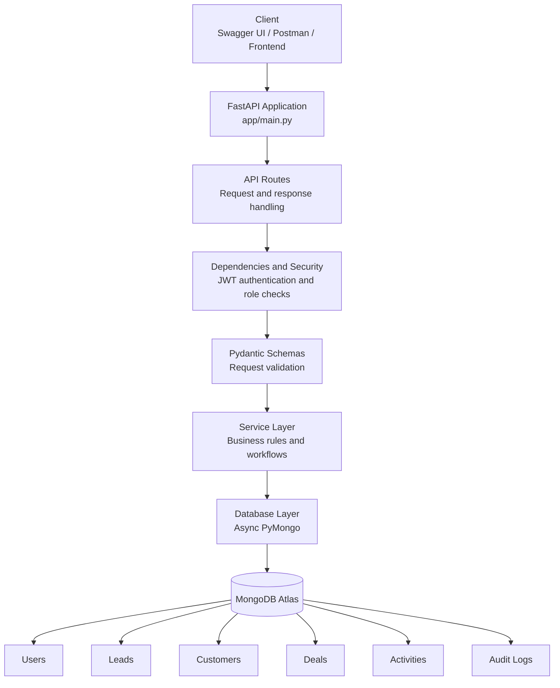
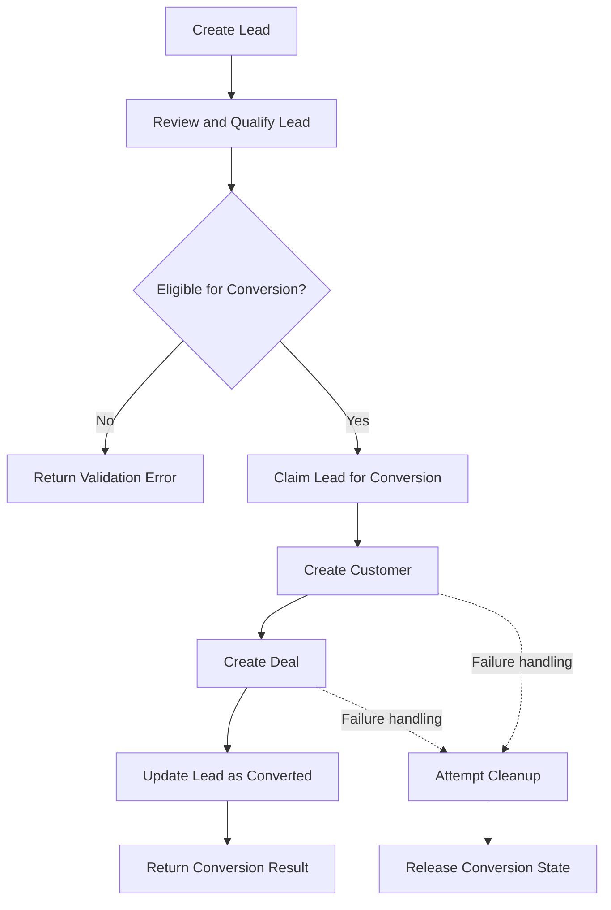
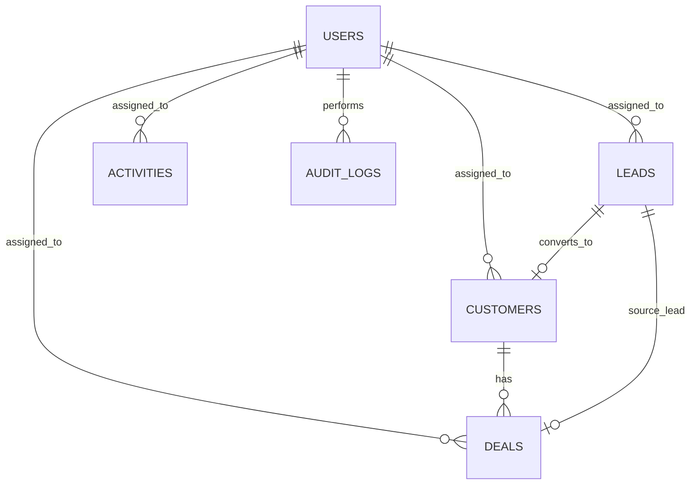
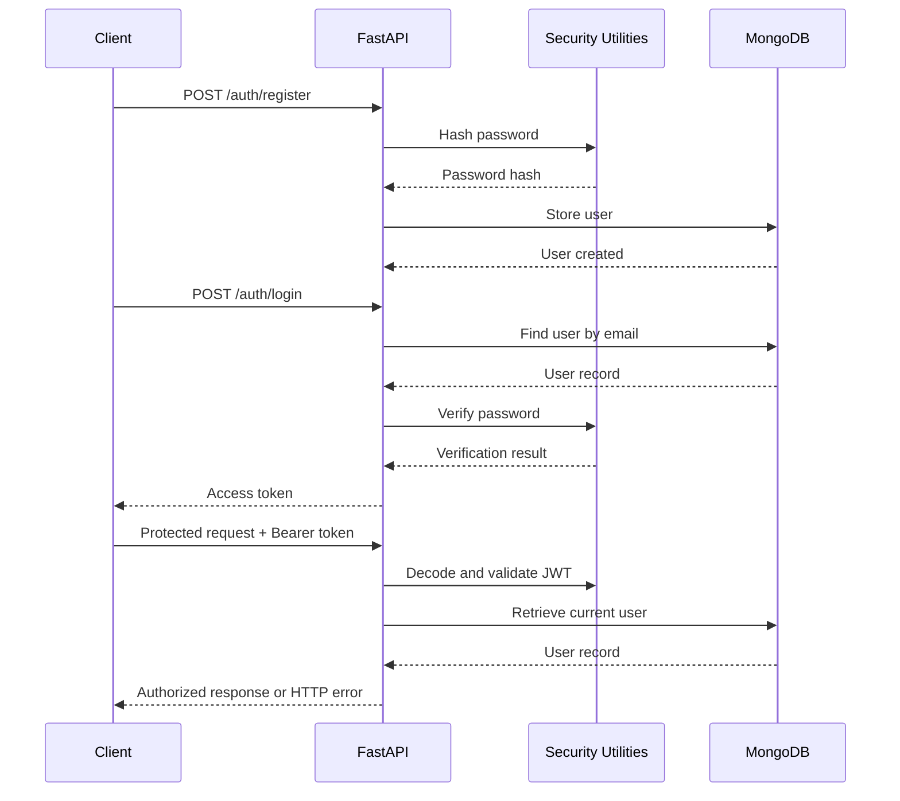

# CRM Sales Management System API

A backend REST API for managing a company's sales workflow, from lead generation and qualification to customer conversion, deal management, follow-ups, and sales analytics.

Built using **Python, FastAPI, MongoDB Atlas, and PyMongo Async**, with JWT-based authentication, role-based access control, request validation, and a modular service-oriented architecture.

**Repository:** [IVTEX Assessment Repository](https://github.com/drashmiranjan/-IVTEX_assesment_repo)

**API documentation:** Available through Swagger UI when the application is running locally.

---

## Table of Contents(Index)

1. [Project Overview](#1-project-overview)
2. [Project Objectives](#2-project-objectives)
3. [Technology Stack](#3-technology-stack)
4. [System Architecture](#4-system-architecture)
5. [Project Folder Structure](#5-project-folder-structure)
6. [How the Application Works](#6-how-the-application-works)
7. [Modules and File Responsibilities](#7-modules-and-file-responsibilities)
8. [Database Design](#8-database-design)
9. [Authentication and Authorization](#9-authentication-and-authorization)
10. [Prerequisites](#10-prerequisites)
11. [Local Installation and Setup](#11-local-installation-and-setup)
12. [Environment Variables](#12-environment-variables)
13. [Running the Application](#13-running-the-application)
14. [API Endpoints](#14-api-endpoints)
15. [Example API Requests](#15-example-api-requests)
16. [Business Rules](#16-business-rules)
17. [Database Indexing](#17-database-indexing)
18. [Error Handling and Security](#18-error-handling-and-security)
19. [Common Problems and Solutions](#19-common-problems-and-solutions)
20. [Deployment](#20-deployment)
21. [Current Scope and Future Improvements](#21-current-scope-and-future-improvements)

---

## 1. Project Overview

The CRM Sales Management System is a backend application designed to help businesses organize and manage their sales operations through REST APIs.

A company can receive leads, assign them to sales executives, track their progress, convert qualified leads into customers, associate deals with those customers, manage follow-up activities, and retrieve sales statistics.

The application separates API routes, business logic, database access, data schemas, security, and configuration into individual modules. This makes the project easier to understand, maintain, test, and extend.

### What problem does it solve?

Without a centralized CRM, sales teams may struggle to track leads, remember follow-ups, maintain customer information, and understand their sales pipeline.

This system provides a backend foundation for managing those operations through authenticated API requests.

### Intended users

- **Administrators:** Manage CRM users and oversee operations, subject to implemented permissions.
- **Sales Managers:** Monitor team sales activity and manage sales operations, subject to implemented permissions.
- **Sales Executives:** Work with assigned leads, customers, deals, and follow-ups, subject to implemented permissions.

This repository contains the backend. A separate frontend is not required to run or test the APIs.

---

## 2. Project Objectives

The project is designed to demonstrate:

- RESTful API development with FastAPI.
- Asynchronous MongoDB access using PyMongo Async.
- Authentication using JWT tokens.
- Password hashing using bcrypt.
- Role-based authorization and protected endpoints.
- Modular application architecture.
- Request validation using Pydantic.
- Lead, customer, deal, and activity management.
- Lead-to-customer conversion workflows.
- Search, filtering, and pagination where implemented.
- MongoDB indexing for frequently queried fields.
- Automatic API documentation through OpenAPI and Swagger UI.
- Environment-based configuration.

---

## 3. Technology Stack

| Technology | Purpose |
|---|---|
| Python 3.13 | Backend programming language used during development |
| FastAPI | REST API framework |
| Uvicorn | ASGI server used to run the application |
| MongoDB Atlas | Cloud-hosted document database |
| PyMongo Async | Asynchronous MongoDB operations |
| Pydantic | Request validation and data schemas |
| pydantic-settings | Environment variable and configuration management |
| PyJWT | JWT token creation and verification |
| bcrypt | Password hashing and verification |
| Certifi | CA certificate bundle for secure TLS connections |
| Git and GitHub | Version control and source code hosting |
| Swagger UI / OpenAPI | Interactive API documentation |

**Database driver note:** This project uses Python and PyMongo Async rather than Node.js, Express.js, and Mongoose. Mongoose is a Node.js ODM; PyMongo is the MongoDB driver used by this Python application.

---

## 4. System Architecture

The application follows a layered architecture. Each layer has a specific responsibility, keeping HTTP handling separate from business rules and database operations.

### High-level architecture



### What happens when an API is called?

1. A client sends an HTTP request to a FastAPI endpoint.
2. The route receives the request and extracts parameters or body data.
3. Authentication dependencies verify the JWT when required.
4. Pydantic schemas validate incoming data.
5. The service layer applies the relevant business rules.
6. The database layer executes MongoDB operations.
7. The route returns the resulting data or an HTTP error response.

Not every endpoint necessarily follows every layer in precisely this order; the diagram illustrates the intended architecture.

### Lead-to-customer conversion flow



The conversion service contains logic to prevent duplicate conversions and attempt cleanup after failures. Database transactions and crash-safe atomic conversion should be verified separately before describing the workflow as fully transactional.

---

## 5. Project Folder Structure

The main application structure is:

```text
crm-sales-management/
│
├── app/
│   ├── __init__.py
│   │
│   ├── main.py
│   │
│   ├── api/
│   │   ├── __init__.py
│   │   ├── dependencies.py
│   │   └── routes/
│   │       ├── __init__.py
│   │       ├── auth.py
│   │       ├── users.py
│   │       ├── leads.py
│   │       ├── customers.py
│   │       ├── deals.py
│   │       ├── activities.py
│   │       ├── timeline.py
│   │       └── analytics.py
│   │
│   ├── core/
│   │   ├── __init__.py
│   │   ├── config.py
│   │   └── security.py
│   │
│   ├── db/
│   │   ├── __init__.py
│   │   ├── mongodb.py
│   │   └── indexes.py
│   │
│   ├── middleware/
│   │   └── __init__.py
│   │
│   ├── models/
│   │   ├── __init__.py
│   │   └── user.py
│   │
│   ├── schemas/
│   │   ├── __init__.py
│   │   ├── user.py
│   │   ├── lead.py
│   │   ├── customer.py
│   │   ├── deal.py
│   │   ├── activity.py
│   │   └── audit.py
│   │
│   ├── services/
│   │   ├── __init__.py
│   │   ├── user_service.py
│   │   ├── user_management_service.py
│   │   ├── lead_service.py
│   │   ├── customer_service.py
│   │   ├── deal_service.py
│   │   ├── activity_service.py
│   │   ├── conversion_service.py
│   │   ├── audit_service.py
│   │   └── analytics_service.py
│   │
│   └── utils/
│       └── __init__.py
│
├── tests/
│
├── .env
├── .env.example
├── .gitignore
├── requirements.txt
└── README.md
```

**Important:** `.env` is a local configuration file and must not be committed to Git. The structure above describes the project layout; the presence of a module does not by itself mean all its features are complete.

---

## 6. How the Application Works

The project is divided into several logical layers.

### 6.1 API layer

Location: `app/api/`

The API layer defines the application's HTTP endpoints and shared dependencies.

Routes receive requests, validate or extract parameters, call services, and translate expected failures into HTTP responses.

### 6.2 Service layer

Location: `app/services/`

The service layer contains business operations, such as creating users, managing leads, converting leads, calculating analytics, and working with activities.

Keeping this logic out of route handlers makes it easier to maintain and reuse.

### 6.3 Schema layer

Location: `app/schemas/`

Pydantic schemas define the expected shape of API input and output data, along with field types, required values, and applicable constraints.

### 6.4 Database layer

Location: `app/db/`

This layer establishes the MongoDB connection and defines indexes used by the application.

### 6.5 Core layer

Location: `app/core/`

This layer contains shared application configuration and security utilities, including token and password operations.

---

## 7. Modules and File Responsibilities

### Application entry point

| File | Responsibility |
|---|---|
| `app/main.py` | Creates the FastAPI application, configures startup and shutdown behavior, checks database connectivity, initializes indexes, and registers routers. |
| `app/__init__.py` | Marks `app` as a Python package. |

### API routes and dependencies

| File | Responsibility |
|---|---|
| `app/api/dependencies.py` | Extracts and validates authentication tokens, retrieves the current user, and provides role-checking dependencies. |
| `app/api/routes/auth.py` | Registration, login, and current-user authentication endpoints. |
| `app/api/routes/users.py` | User management endpoints, including listing, retrieving, and changing user status where implemented. |
| `app/api/routes/leads.py` | Lead creation, listing, retrieval, updating, and conversion endpoints. |
| `app/api/routes/customers.py` | Customer management endpoints. |
| `app/api/routes/deals.py` | Deal management endpoints. |
| `app/api/routes/activities.py` | Activity and follow-up endpoints. |
| `app/api/routes/timeline.py` | Retrieves timeline or audit history for supported entities. |
| `app/api/routes/analytics.py` | Sales analytics endpoint. |
| `app/api/routes/__init__.py` | Marks the routes directory as a Python package. |

### Core configuration and security

| File | Responsibility |
|---|---|
| `app/core/config.py` | Reads application settings and environment variables using Pydantic Settings. |
| `app/core/security.py` | Implements password hashing and verification, and JWT token creation and decoding. |
| `app/core/__init__.py` | Marks the core directory as a Python package. |

### Database

| File | Responsibility |
|---|---|
| `app/db/mongodb.py` | Creates the asynchronous MongoDB client and exposes database access. |
| `app/db/indexes.py` | Creates indexes on frequently queried fields to support common database operations. |
| `app/db/__init__.py` | Marks the database directory as a Python package. |

### Models and schemas

| File | Responsibility |
|---|---|
| `app/models/user.py` | Contains the user model-related definitions. |
| `app/schemas/user.py` | User input/output schemas and role definitions. |
| `app/schemas/lead.py` | Lead creation, update, and conversion request schemas. |
| `app/schemas/customer.py` | Customer request and response schemas. |
| `app/schemas/deal.py` | Deal request and response schemas. |
| `app/schemas/activity.py` | Activity request and response schemas. |
| `app/schemas/audit.py` | Audit/timeline-related schemas. |

MongoDB is schema-flexible, so these Pydantic schemas validate API data; they are not equivalent to relational database table definitions.

### Business services

| File | Responsibility |
|---|---|
| `app/services/user_service.py` | User registration, password handling, and login-related operations. |
| `app/services/user_management_service.py` | Administrative user management operations. |
| `app/services/lead_service.py` | Lead creation, retrieval, listing, filtering, and updating. |
| `app/services/customer_service.py` | Customer-related database operations and business logic. |
| `app/services/deal_service.py` | Deal-related database operations and business logic. |
| `app/services/activity_service.py` | Activity creation and management operations. |
| `app/services/conversion_service.py` | Lead conversion into a customer and a deal, including conversion-state and failure-cleanup logic. |
| `app/services/audit_service.py` | Functions for recording or retrieving audit events. |
| `app/services/analytics_service.py` | Database operations and calculations for sales analytics. |

### Other files

| File or directory | Responsibility |
|---|---|
| `app/middleware/` | Reserved for middleware components; verify which middleware is implemented before claiming specific protections. |
| `app/utils/` | Reserved for shared helper utilities. |
| `tests/` | Intended location for automated tests. |
| `requirements.txt` | Lists the Python packages required by the application. |
| `.env.example` | Documents the configuration variables needed to run the project. |
| `.gitignore` | Excludes secrets, virtual environments, and generated files from Git. |
| `README.md` | Project documentation and setup instructions. |

---

## 8. Database Design

The application uses MongoDB collections rather than relational tables. Documents reference related records using MongoDB ObjectIds where appropriate.

### Main collections

| Collection | Purpose | Example relationships |
|---|---|---|
| `users` | User accounts, roles, and account status. | Assigned leads, customers, deals, and activities. |
| `leads` | Potential customers and lead qualification data. | Assigned user, creator, converted customer, converted deal. |
| `customers` | Customer information. | Original lead, assigned user, related deals. |
| `deals` | Sales opportunities, values, probabilities, and stages. | Customer, assigned user, and intended lead relationship. |
| `activities` | Calls, meetings, reminders, and follow-ups. | Assigned user and related CRM entity. |
| `audit_logs` | Audit/timeline records. | Entity type, entity ID, and actor. |

The actual fields and relationships are determined by the service and schema implementations. Verify the current document structure before relying on optional fields.

### Relationship diagram



The diagram illustrates the intended logical relationships. Actual relationship enforcement, optional references, and referential cleanup depend on the implementation.

### Why use references?

References allow related records to be maintained separately. For example, a customer can have multiple deals without duplicating the complete customer document in every deal.

MongoDB does not automatically enforce foreign-key constraints as a relational database would. The application must validate referenced IDs and maintain relationships correctly.

---

## 9. Authentication and Authorization

The application uses bearer-token authentication with JWT.

### Authentication flow



### Registration and login

1. A user submits registration details.
2. The password is hashed before storage.
3. The user logs in with their email and password.
4. The application verifies the password and returns a JWT access token when authentication succeeds.
5. Protected endpoints use the token to identify the current user.

Passwords must never be returned in API responses.

### Calling a protected endpoint

Add the following HTTP header:

```http
Authorization: Bearer YOUR_ACCESS_TOKEN
```

Replace `YOUR_ACCESS_TOKEN` with the token returned by the login endpoint. Do not commit or share real tokens.

### Roles

The application defines these roles:

- `admin`
- `sales_manager`
- `sales_executive`

The dependency `require_roles()` supports role-based checks. The permissions of individual routes should be verified against the current code and tested with each role.

---

## 10. Prerequisites

Before running the application, install or obtain:

1. **Python 3.11 or newer**, preferably Python 3.13 for the development environment used for this project.
2. **Git**, to clone the repository.
3. A **MongoDB Atlas** account or another compatible MongoDB deployment.
4. MongoDB connection details and a database user with suitable permissions.
5. An internet connection for Atlas access.

No frontend, or local MongoDB installation is required for the documented Atlas setup.

---

## 11. Local Installation and Setup

These instructions are written for someone setting up the project for the first time on Windows.

### Step 1 — Download the project

Open PowerShell and run:

```powershell
git clone https://github.com/drashmiranjan/-IVTEX_assesment_repo.git
cd -IVTEX_assesment_repo
```

If you already have the project folder, open PowerShell in that folder instead.

### Step 2 — Create a virtual environment

Run:

```powershell
python -m venv venv
```

A virtual environment keeps this project's Python packages separate from other projects.

### Step 3 — Activate the virtual environment

```powershell
.\venv\Scripts\Activate.ps1
```

If PowerShell blocks activation, you can use Command Prompt instead:

```bat
venv\Scripts\activate.bat
```

When activation succeeds, the terminal normally displays `(venv)`.

### Step 4 — Install dependencies

```powershell
python -m pip install --upgrade pip
pip install -r requirements.txt
```

Wait until installation finishes successfully.

### Step 5 — Create the environment configuration

Copy the example file:

```powershell
Copy-Item .env.example .env
```

Open `.env` in a text editor and replace the placeholder values with your own configuration.

**Never upload the real `.env` file to GitHub.**

### Step 6 — Configure MongoDB Atlas

1. Sign in to MongoDB Atlas.
2. Create or select a MongoDB cluster.
3. Create a database user with an appropriate password.
4. Configure Atlas network access to permit your development machine to connect.
5. Copy the cluster connection string.
6. Place the connection string in the `MONGODB_URL` setting in `.env`.
7. Set `MONGODB_DATABASE` to `crm_sales_management`, or another database name that matches your configuration.

Use the actual cluster hostname supplied by Atlas. Do not use the placeholder hostname from `.env.example`.

If your password contains characters such as `@`, `:`, `/`, or `#`, URL-encode the password when placing it in the connection string.

For production, restrict network access to trusted sources instead of leaving the database open to all IP addresses.

---

## 12. Environment Variables

The `.env.example` file documents the expected configuration.

| Variable | Purpose |
|---|---|
| `APP_NAME` | Application display name. |
| `APP_ENV` | Environment, such as development or production. |
| `DEBUG` | Development/debug configuration. |
| `MONGODB_URL` | MongoDB connection URI. |
| `MONGODB_DATABASE` | Database name. |
| `JWT_SECRET_KEY` | Private key used to sign JWT tokens. |
| `JWT_ALGORITHM` | JWT signing algorithm; currently configured as HS256. |
| `ACCESS_TOKEN_EXPIRE_MINUTES` | Access token lifetime in minutes. |
| `REFRESH_TOKEN_EXPIRE_DAYS` | Refresh token lifetime setting. Verify its use in the current implementation before relying on refresh-token support. |
| `CORS_ORIGINS` | Allowed frontend origins, according to the application's CORS configuration. |

### Example configuration

```dotenv
APP_NAME=CRM Sales Management API
APP_ENV=development
DEBUG=true

MONGODB_URL=mongodb+srv://<USERNAME>:<PASSWORD>@<CLUSTER_HOST>/
MONGODB_DATABASE=crm_sales_management

JWT_SECRET_KEY=replace_with_a_random_secret_of_at_least_32_bytes
JWT_ALGORITHM=HS256

ACCESS_TOKEN_EXPIRE_MINUTES=30
REFRESH_TOKEN_EXPIRE_DAYS=7

CORS_ORIGINS=http://localhost:3000
```

The values above are examples, not working credentials. Replace the placeholders with your own values.

Generate a strong, random JWT secret for each environment. Keep database credentials and signing keys private. Never commit them to Git.

---

## 13. Running the Application

Once dependencies and environment variables are configured, start the server from the project root.

```powershell
uvicorn app.main:app --reload
```

The application should start if configuration is valid, the database is reachable, and required indexes can be created.

The local API base URL is:

`http://127.0.0.1:8000`

### Interactive API documentation

Open these URLs in your browser:

| URL | Purpose |
|---|---|
| `http://127.0.0.1:8000/docs` | Swagger UI: explore and execute API requests. |
| `http://127.0.0.1:8000/redoc` | ReDoc API documentation. |
| `http://127.0.0.1:8000/openapi.json` | OpenAPI specification. |
| `http://127.0.0.1:8000/health` | Health endpoint. |

Swagger UI is the easiest way for a beginner to test the backend without writing a frontend.

### First API test

1. Start the application.
2. Open `/docs`.
3. Find `POST /auth/register`.
4. Enter valid registration data and execute the request.
5. Use `POST /auth/login` with the registered credentials.
6. Copy the access token from the login response.
7. Click **Authorize** in Swagger UI and enter the token as requested.
8. Try `GET /auth/me` to retrieve the authenticated user's profile.

Registration currently assigns the `sales_executive` role by default. Do not assume that registering an account creates an administrator.

---

## 14. API Endpoints

The following routes have been registered in the application. Request methods, body schemas, and response models are available in Swagger UI.

| Method | Endpoint | Purpose |
|---|---|---|
| `GET` | `/health` | Health check. |
| `POST` | `/auth/register` | Register a user. |
| `POST` | `/auth/login` | Authenticate a user. |
| `GET` | `/auth/me` | Get the current authenticated user. |
| `GET` | `/users/` | User management/listing. |
| `GET` | `/users/{user_id}` | Retrieve a user by ID. |
| `PATCH` | `/users/{user_id}/status` | Update user status. |
| `GET` | `/leads/` | List leads. |
| `POST` | `/leads/` | Create a lead. |
| `GET` | `/leads/{lead_id}` | Retrieve a lead. |
| `PATCH` | `/leads/{lead_id}` | Update a lead. |
| `POST` | `/leads/{lead_id}/convert` | Convert a lead. |
| `GET` | `/customers/` | List customers. |
| `POST` | `/customers/` | Create a customer. |
| `GET` | `/customers/{customer_id}` | Retrieve a customer. |
| `PATCH` | `/customers/{customer_id}` | Update a customer. |
| `GET` | `/deals/` | List deals. |
| `POST` | `/deals/` | Create a deal. |
| `GET` | `/deals/{deal_id}` | Retrieve a deal. |
| `PATCH` | `/deals/{deal_id}` | Update a deal. |
| `GET` | `/activities/` | List activities. |
| `POST` | `/activities/` | Create an activity. |
| `GET` | `/activities/{activity_id}` | Retrieve an activity. |
| `PATCH` | `/activities/{activity_id}` | Update an activity. |
| `GET` | `/timeline/{entity_type}/{entity_id}` | Retrieve timeline events for an entity. |
| `GET` | `/analytics/sales` | Retrieve sales analytics. |

The table summarizes registered route paths and their intended purposes. Check `/docs` for the exact supported HTTP methods and query parameters; not every assessment-required operation is confirmed to be implemented.

### Common HTTP status codes

| Status | Meaning |
|---|---|
| `200 OK` | Request succeeded. |
| `201 Created` | A resource was created. |
| `400 Bad Request` | Invalid request or business-rule failure. |
| `401 Unauthorized` | Authentication is missing or invalid. |
| `403 Forbidden` | The user lacks permission. |
| `404 Not Found` | The requested resource does not exist. |
| `409 Conflict` | A conflicting operation, such as duplicate conversion, may have occurred. |
| `422 Unprocessable Entity` | FastAPI/Pydantic request validation failed. |
| `500 Internal Server Error` | An unexpected server error occurred. |
| `503 Service Unavailable` | A service dependency may be unavailable. |

The exact status code depends on the endpoint's current error handling.

---

## 15. Example API Requests

The following examples illustrate the intended API usage. Confirm the exact field names and required values in Swagger UI before executing them.

### Register a user

**Request**

```http
POST /auth/register
Content-Type: application/json
```

Example body:

```json
{
  "name": "Alex Johnson",
  "email": "alex@example.com",
  "password": "Use-A-Strong-Password-Here"
}
```

A successful registration returns user information without the password hash.

### Log in

**Request**

```http
POST /auth/login
Content-Type: application/json
```

Example body:

```json
{
  "email": "alex@example.com",
  "password": "Use-A-Strong-Password-Here"
}
```

Use the access token from the successful login response to call protected endpoints.

### Create a lead

**Request**

```http
POST /leads/
Authorization: Bearer YOUR_ACCESS_TOKEN
Content-Type: application/json
```

Illustrative body:

```json
{
  "name": "Taylor Morgan",
  "email": "taylor@example.com",
  "phone": "+15551234567",
  "company": "Example Company",
  "source": "website",
  "priority": "medium",
  "notes": "Interested in a product demonstration"
}
```

Use the enum values and required fields shown in the actual lead schema. This example may need adjustment to match the current validation rules.

### List leads

```http
GET /leads/?page=1&page_size=10
Authorization: Bearer YOUR_ACCESS_TOKEN
```

The lead listing service supports pagination and multiple filters. Available filters are documented in the route and schema implementation.

### Retrieve the current user

```http
GET /auth/me
Authorization: Bearer YOUR_ACCESS_TOKEN
```

This endpoint identifies the currently authenticated account.

---

## 16. Business Rules

The application contains business logic for key CRM workflows.

### Lead management

- Leads have fields such as name, source, priority, status, and assignment.
- Lead listing supports pagination and filtering.
- Sales executives are restricted to assigned leads in the lead service.
- Lead updates validate identifiers and apply the relevant update rules.

### Lead conversion

- The conversion service validates the lead ID and deal information.
- Deal value must be greater than zero.
- Deal probability must be between 0 and 100.
- A lead is claimed for conversion to reduce duplicate conversion attempts.
- The service creates a customer and a deal, then marks the lead as converted.
- Failure handling attempts to remove created records and release the conversion state.

A fully transactional, crash-safe conversion is not established merely by this cleanup logic. MongoDB transaction support and all relationship requirements should be verified before treating conversion as atomic.

### Deal management

The intended sales pipeline includes:

1. Qualification
2. Discovery
3. Proposal
4. Negotiation
5. Won
6. Lost

Deal rules should validate stage changes, amounts, probability, expected revenue, closing dates, and the reason for a lost deal. Verify the current implementation of each rule in Swagger and the deal service.

### Activities and follow-ups

Activities represent sales tasks such as calls, meetings, reminders, and follow-ups. They may be associated with CRM entities and assigned users.

Overdue status should be determined using the activity's due date and completion status. Verify the current service behavior and endpoint support before relying on all activity transitions.

### Authorization

Access to protected endpoints depends on authentication and, where configured, the current user's role and resource ownership. Authorization should be tested for every sensitive operation, including access to other users' records.

---

## 17. Database Indexing

The application creates indexes during startup using `app/db/indexes.py`.

The configured indexes include:

| Collection | Indexed fields | Purpose |
|---|---|---|
| `users` | `email` (unique) | Prevent duplicate user emails and speed up email lookup. |
| `users` | `role`, `is_active` | Support role and account-status filtering. |
| `leads` | `status` | Support lead-status filtering. |
| `leads` | `source` | Support lead-source filtering. |
| `leads` | `assigned_to`, `created_at` | Support assignment-based queries and recent-first listing. |
| `customers` | `email` | Support customer email lookups. |
| `customers` | `assigned_to`, `created_at` | Support assignment-based listing. |
| `deals` | `stage` | Support sales-stage filtering. |
| `deals` | `assigned_to`, `created_at` | Support assigned-deal listing. |
| `deals` | `customer_id` | Support retrieval of deals associated with a customer. |
| `activities` | `assigned_to`, `due_date` | Support assignment and due-date queries. |
| `activities` | `status`, `due_date` | Support pending and overdue activity queries. |
| `audit_logs` | `entity_type`, `entity_id`, `created_at` | Support entity timelines ordered by creation time. |

Indexes improve query performance when they match actual query patterns, but they also consume storage and add overhead to writes. Indexes should be reviewed using real queries and MongoDB explain plans as the application grows.

---

## 18. Error Handling and Security

### Security measures included in the project structure

- Password hashing using bcrypt.
- JWT-based access-token authentication.
- Authentication dependencies for protected endpoints.
- Role-checking support.
- Pydantic request validation.
- Environment-based configuration.
- TLS certificate support for MongoDB connections.
- A Git ignore policy that excludes `.env` and virtual environments.

### Security checks required before production

- Keep JWT secrets and database credentials private.
- Rotate any secret that has been exposed.
- Use a strong JWT signing key.
- Restrict MongoDB Atlas network access and database permissions.
- Configure CORS for only the required frontend origins.
- Verify security headers and rate limiting; do not assume they are active simply because the project contains a middleware directory.
- Ensure authorization checks cover all reads, updates, deletes, and assignments.
- Ensure unexpected exceptions do not expose stack traces or database details.
- Verify logout and refresh-token behavior before documenting them as implemented.
- Use HTTPS in production.

---

## 19. Common Problems and Solutions

### Problem: `ModuleNotFoundError`

**Cause:** A required Python package is missing or the wrong environment is active.

**Solution:**

```powershell
.\venv\Scripts\Activate.ps1
pip install -r requirements.txt
```

### Problem: MongoDB connection failure

**Possible causes:**

- Incorrect connection URI.
- Incorrect database username or password.
- Atlas network access does not allow your IP.
- DNS or TLS connection issues.
- Incorrect environment variable names.

**Solution:** Check `.env`, verify the Atlas connection string, and confirm network access. Never paste real database credentials into logs, issues, or public repositories.

### Problem: `401 Unauthorized`

**Cause:** The token is missing, expired, invalid, or associated with an unavailable/inactive account.

**Solution:** Log in again, authorize Swagger with the new access token, and retry the request.

### Problem: `403 Forbidden`

**Cause:** The authenticated user does not have the required permission or ownership.

**Solution:** Verify the account role and the resource assignment. Do not bypass authorization to make the request succeed.

### Problem: Port 8000 is already in use

Run the application on another port:

```powershell
uvicorn app.main:app --reload --port 8001
```

Then open `http://127.0.0.1:8001/docs`.

### Problem: `.env` appears in Git status

Check the ignore rules:

```bash
git check-ignore .env
```

If `.env` was already committed in the past, adding it to `.gitignore` alone does not remove it from Git history. Remove it from tracking and rotate any exposed secrets.

---

## 20. Deployment

The project can be deployed to a hosting service that supports Python ASGI applications, with MongoDB Atlas used as the database.

A deployment should include:

1. A production environment with the required Python dependencies.
2. A valid MongoDB Atlas connection string.
3. Secure JWT configuration.
4. Appropriate Atlas network access.
5. An ASGI start command, for example:

   ```bash
   uvicorn app.main:app --host 0.0.0.0 --port $PORT
   ```

6. HTTPS and appropriate production security settings.
7. A working health endpoint and verified database connectivity.

## 21. Current Scope and Future Improvements

The repository provides a modular FastAPI foundation with authentication, user and CRM route modules, asynchronous MongoDB access, conversion logic, analytics services, and index initialization.

The following areas should be verified or completed before describing the system as fully assessment-compliant:

- Logout and refresh-token lifecycle.
- Complete administrative user CRUD and filtering.
- Lead assignment/reassignment and permitted deletion.
- Lead and deal date-range filtering and sorting.
- Customer and deal ownership checks across every endpoint.
- Complete deal-stage transition validation and lost-deal reasons.
- Activity completion and overdue-status behavior.
- Audit events consistently written for important business actions.
- Lead reference on converted deals and customer/deal relationship integrity.
- Atomic or otherwise crash-safe lead conversion.
- Centralized error handling, CORS, security headers, and rate limiting.
- Automated tests and verification of all role permissions.
- Production deployment and live endpoint testing.

These are verification targets, not claims that each item is missing. The current implementation should be reviewed and tested against each requirement.

### Future improvements

- Add automated unit and integration tests.
- Provide a Postman collection with example requests.
- Add structured logging and monitoring.
- Improve audit-history consistency.
- Add production deployment automation.
- Document verified role permissions and sample responses.
- Optimize database queries using measured query performance.

---

## Conclusion

The CRM Sales Management System demonstrates a modular backend architecture for managing users, leads, customers, deals, activities, and sales analytics through REST APIs.

The project uses FastAPI for HTTP handling, Pydantic for data validation, PyMongo Async for MongoDB access, and JWT-based authentication for protected endpoints.

To get started, clone the repository, create a virtual environment, install dependencies, configure `.env`, start the application, and open Swagger UI at `/docs`.

**GitHub Repository:** [IVTEX Assessment Repository](https://github.com/drashmiranjan/-IVTEX_assesment_repo)

